# PrometIA

**O que prometia, entrega.**

PrometIA é um protótipo de uma camada de IA para o ecossistema da YouShop. Ela confere se **o que é prometido na divulgação** (o vídeo do creator ou a página do produtor) bate com **o que o comprador recebe** e fecha o ciclo quando não bate.

**🔗 Demo ao vivo: [prometiayoushop.netlify.app](https://prometiayoushop.netlify.app/)**

> Protótipo conceitual · Desafio de Inovação do Programa de Estágio YouShop 2027 · não oficial · todos os dados são fictícios.

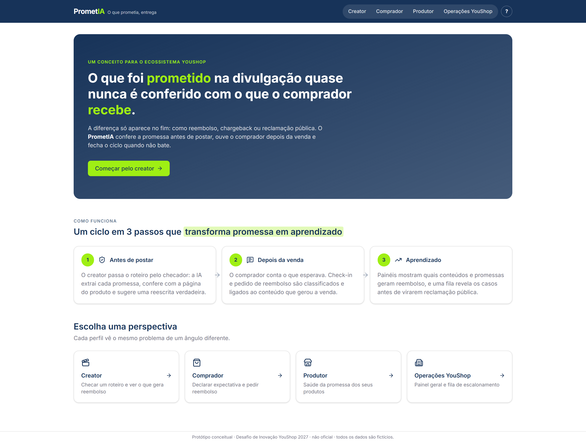

---

## Sumário

- [O problema](#o-problema)
- [A solução em 3 passos](#a-solução-em-3-passos)
- [História da demo](#história-da-demo)
- [Telas](#telas)
- [Como a IA é usada](#como-a-ia-é-usada)
- [Cache e plano B](#cache-e-plano-b)
- [Stack](#stack)
- [Rodar localmente](#rodar-localmente)
- [Scripts](#scripts)
- [Estrutura do projeto](#estrutura-do-projeto)
- [Dados fictícios](#dados-fictícios)
- [Fora do escopo](#fora-do-escopo)

---

## O problema

Ninguém confere se o que o creator promete na divulgação bate com o que o comprador recebe. A diferença só aparece no fim, como reembolso, chargeback ou reclamação pública. Quando isso acontece, ninguém sabe qual vídeo ou qual frase causou o problema.

## A solução em 3 passos

| Momento | O que acontece |
|---|---|
| **Antes de postar** | O creator passa o roteiro pelo **Checador**. A IA extrai cada promessa, classifica como ✅ sustentada, ⚠️ exagerada ou ❌ proibida, mostra a evidência na página de vendas e sugere uma reescrita. Cada conteúdo checado ganha um **link exclusivo**, então dá para saber qual vídeo gerou cada venda. |
| **Depois da venda** | O comprador conta o que espera (página de obrigado) e responde a um check-in (card no YouClass). Se pedir reembolso, ele diz o que esperava e o que recebeu, e a IA classifica o motivo. **O botão de reembolso nunca fica escondido.** |
| **Aprendizado** | Os painéis mostram quais conteúdos e promessas geram reembolso. Uma **fila de escalonamento** mostra os casos graves antes de virarem reclamação pública. |

O PrometIA **orienta, não bloqueia**: a decisão de publicar é sempre do creator.

---

## História da demo

O protótipo foi pensado para este roteiro de 2 a 3 minutos:

1. **Creator "Ana Reels"** abre o *Checador*, escolhe o produto **"Renda com Reels"** e usa o roteiro de exemplo. O PrometIA retorna:
   - ❌ "você vai faturar R$10 mil já no primeiro mês": ganho garantido, a página não sustenta.
   - ⚠️ "é só postar 1 vídeo por dia e o algoritmo faz o resto": exagero, o curso fala em 3 meses de prática.
   - ✅ "são 6 módulos com aulas práticas de edição": sustentada pela página.

   Depois ela gera o link do conteúdo: `youshop.co/r/ana-reels/renda-reels?c=ct_013`.
2. **Comprador:** página de obrigado → marca "Faturar rápido" → card do YouClass → responde 👎 → **Solicitar reembolso** → escreve o que esperava. A IA classifica ao vivo: *expectativa desalinhada, gravidade alta, promessa relacionada: ganho garantido*.
3. **Creator → Meus conteúdos:** os conteúdos com a promessa "R$10k" têm taxa de reembolso cerca de **3x maior**, com um card de insights gerado por IA.
4. **Operações (YouShop):** painel *Saúde da Promessa* e **fila de escalonamento** com o caso do passo 2 (frustração alta e produtor sem resposta há 52h), com resumo do caso e ação sugerida.

Na primeira visita, um **tour guiado** (8 passos, com `driver.js`) apresenta o projeto. Ele pode ser reaberto pelo botão **"?"** no header.

---

## Telas

O header tem um **seletor de perfil** (Creator · Comprador · Produtor · Operações YouShop). Cada perfil vê o mesmo problema de um ângulo diferente.

### Creator: Checador (`/creator/checador`)

Selecione o produto, cole o roteiro e clique em **"Checar promessas"**. Cada promessa mostra o trecho destacado, o status, a evidência, o motivo e uma reescrita com botão de copiar.

| Roteiro preenchido | Resultado | Link gerado |
|---|---|---|
| 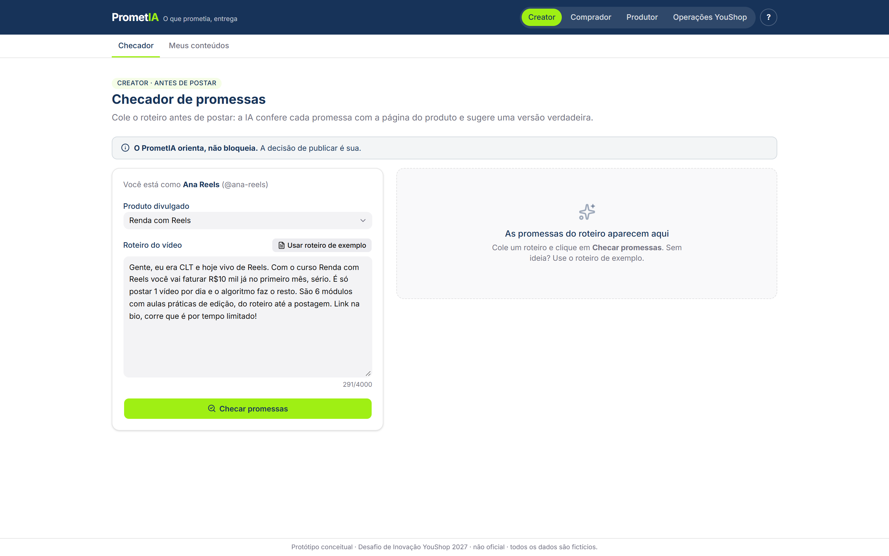 | 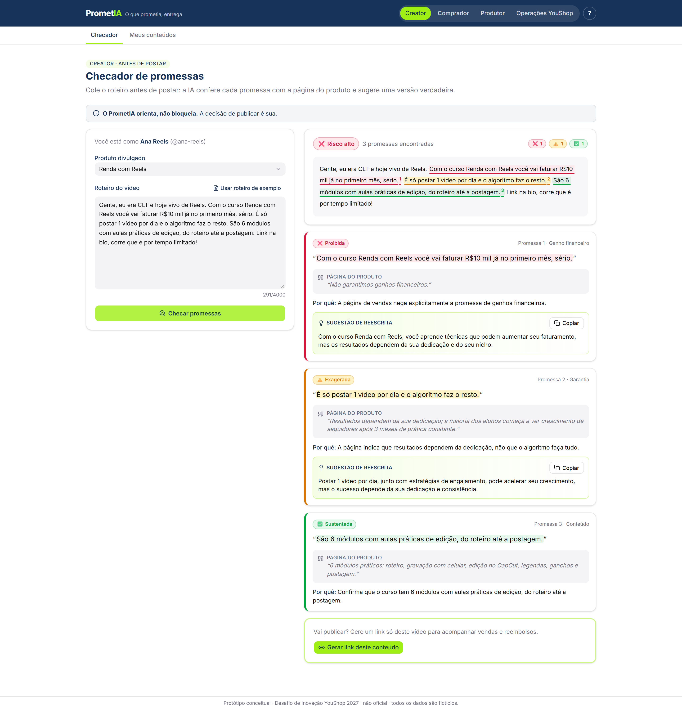 | 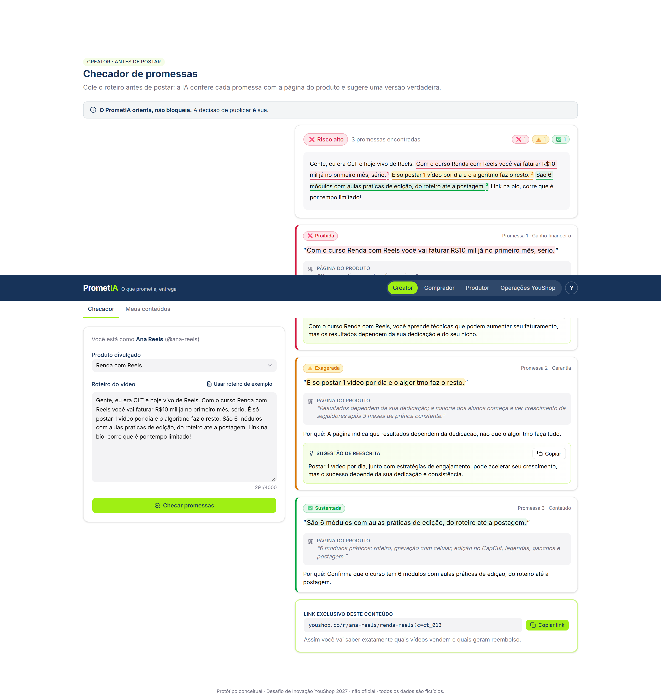 |

### Creator: Meus conteúdos (`/creator/conteudos`)

Mostra os KPIs (vendas, taxa de reembolso, "vendas que ficam", comissão preservada e perdida), uma tabela e um gráfico por conteúdo, além do card **Insights do PrometIA**.

| Ana Reels (estilo exagerado) | Bruno Edita (estilo cauteloso) |
|---|---|
| 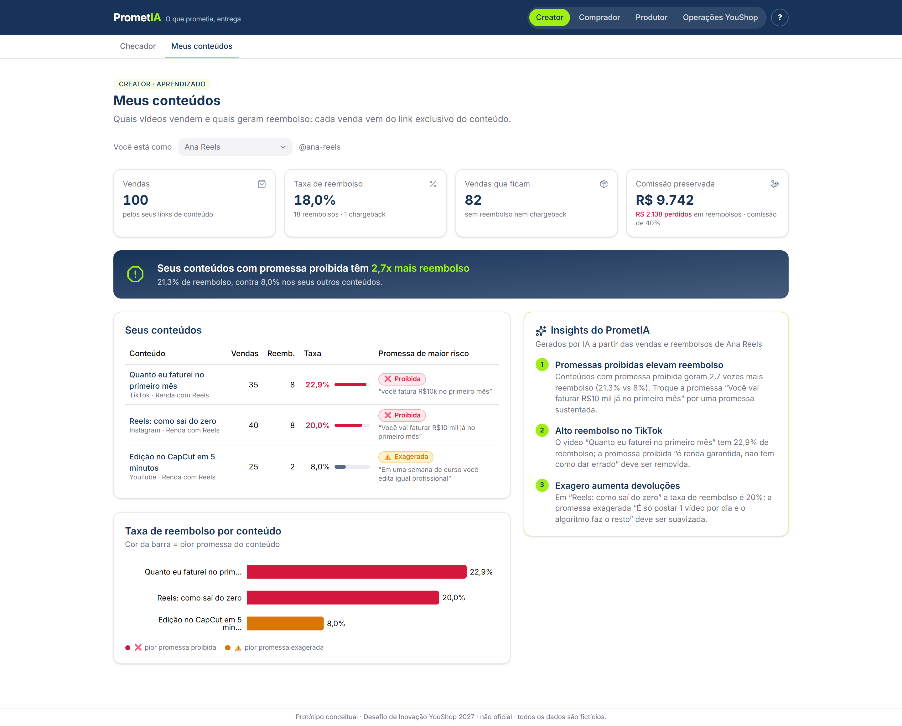 | 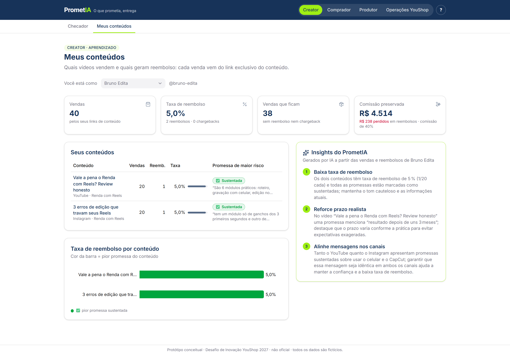 |

### Comprador: Obrigado, YouClass e Reembolso (`/comprador/*`)

Fluxo simulado dentro de uma moldura de celular. No reembolso, um painel lateral mostra **o que a YouShop vê**: tipo de frustração, gravidade, promessa relacionada e conteúdo de origem.

| Obrigado | Check-in no YouClass | Reembolso classificado |
|---|---|---|
| 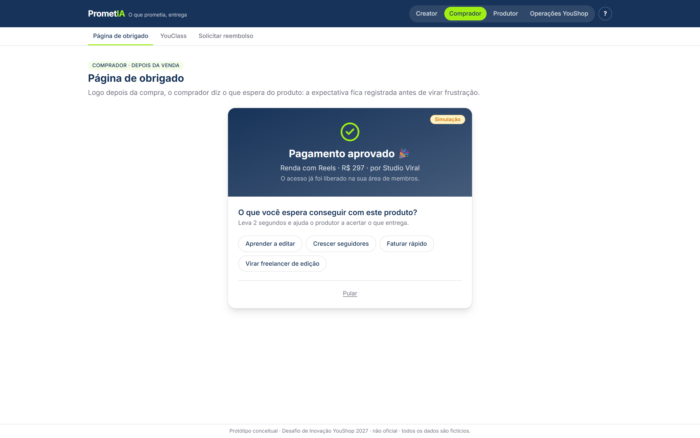 | 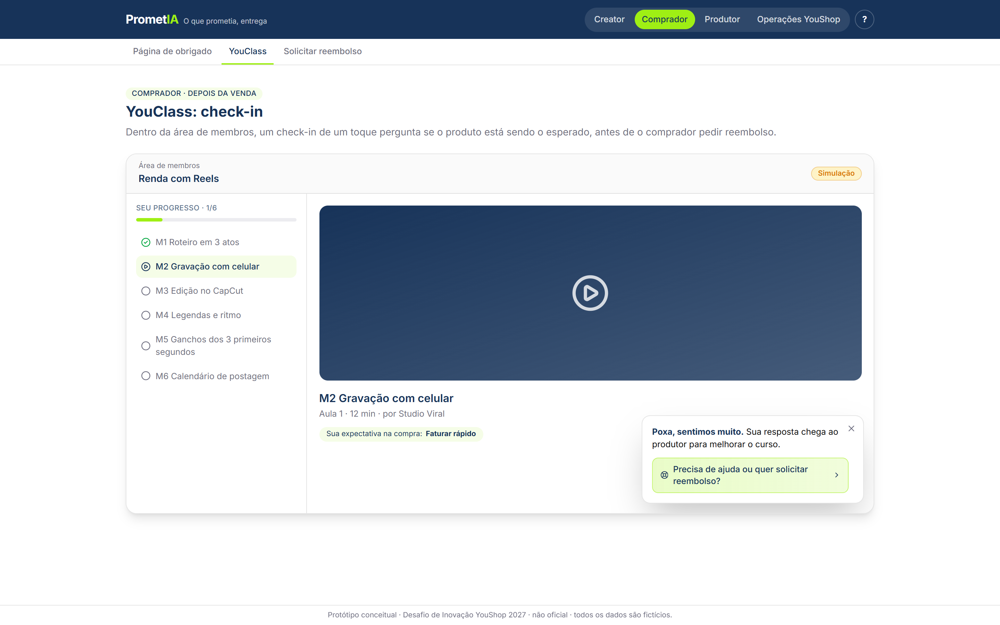 | 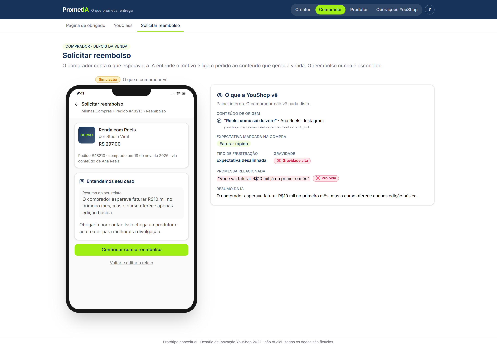 |

Quando o problema tem solução (acesso técnico, por exemplo), a IA oferece ajuda, e o botão **"Continuar com o reembolso"** continua com o mesmo destaque:

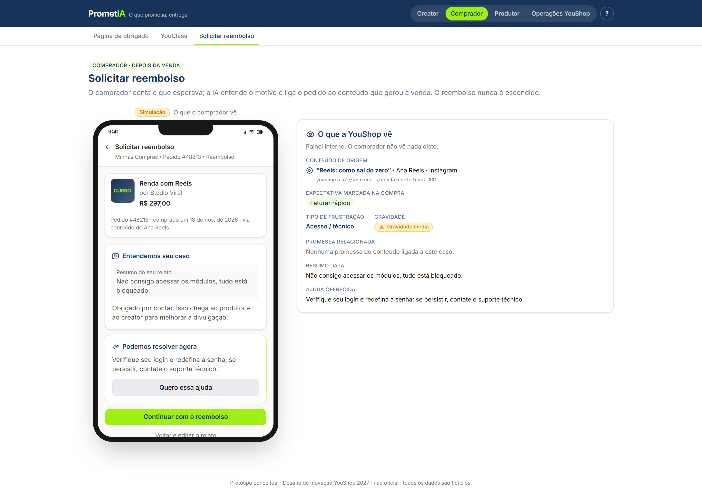

### Operações YouShop: Saúde da Promessa (`/operacoes`)

Mostra os KPIs globais, as tabelas por produto e por creator, os tipos de frustração e a **fila de escalonamento** (gravidade alta e produtor sem resposta ou com mais de 48h). Em "Ver caso", a IA resume o caso e sugere uma ação.

| Painel | Caso aberto |
|---|---|
| 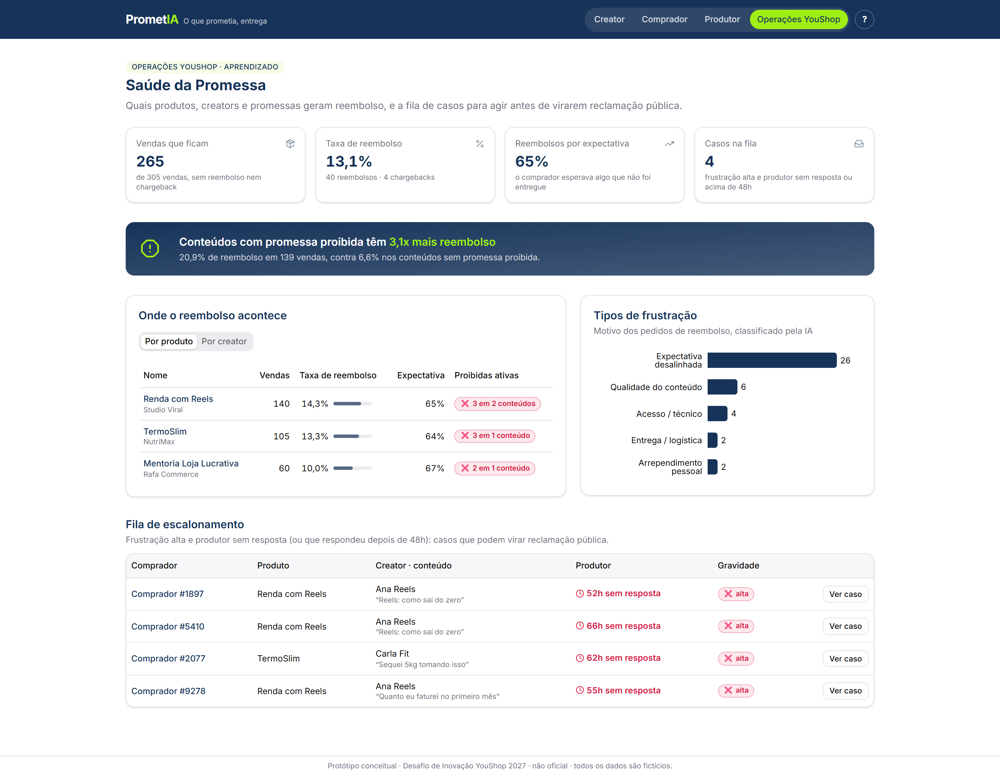 | 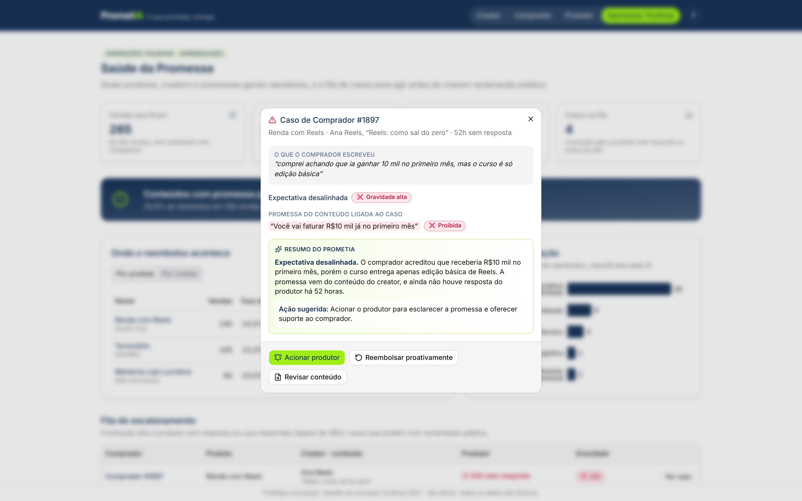 |

### Produtor (`/produtor`)

Usa os mesmos componentes, filtrados pelos produtos de um produtor (Studio Viral, NutriMax, Rafa Commerce).

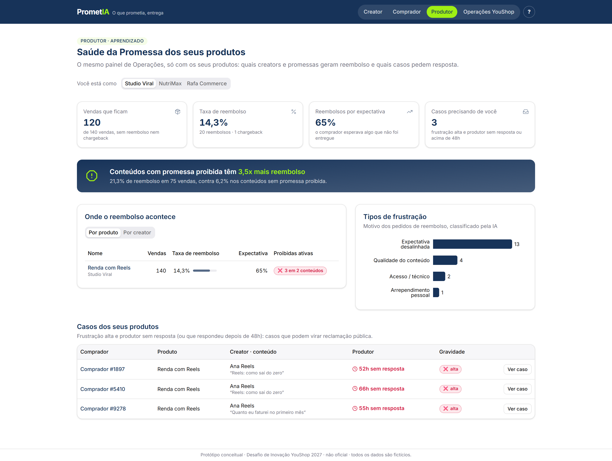

> Todas as capturas estão na pasta [`prints/`](prints/).

---

## Como a IA é usada

A IA real roda em **3 pontos**, sempre em **Route Handlers do servidor**. A chave `GROQ_API_KEY` nunca chega ao navegador. As respostas usam **Structured Outputs estritos** (JSON Schema) e passam por uma limpeza antes de chegar à tela.

| Rota | O que faz | Entrada | Saída |
|---|---|---|---|
| `POST /api/check-claims` | Extrai e classifica as promessas do roteiro em relação à página de vendas | `productId`, `script` | risco geral + lista de promessas (status, evidência, motivo, reescrita, categoria) |
| `POST /api/classify-feedback` | Classifica o pedido de reembolso e liga a uma promessa do conteúdo de origem | `productId`, `contentId`, `text`, `reason?` | tipo de frustração, gravidade, promessa relacionada, resumo, oferta de ajuda opcional |
| `POST /api/insight` | Gera insights para o creator ou para um caso da fila | `scope` (`creator` ou `case`) + `id`; o servidor monta os dados agregados | até 3 insights (creator) ou 2 insights + ação sugerida (caso) |

Regras importantes:

- A promessa relacionada só vale se for uma promessa real do conteúdo de origem, e só para *expectativa desalinhada*.
- Em *expectativa desalinhada* e *arrependimento pessoal*, o caminho é o reembolso: a IA não oferece "ajuda" no lugar dele.
- Prompts em `lib/prompts.ts`, schemas em `lib/schemas.ts`, pós-processamento em `lib/ai.ts`.

---

## Cache e plano B

A demo precisa rodar sem travar, mesmo no plano gratuito do Groq (8.000 tokens/min). Por isso `lib/cache.ts` funciona assim:

1. **Cache:** a chave é um hash da rota com a entrada normalizada. Se ela existe em `data/ai-cache.json` (ou na memória), a resposta volta com um pequeno atraso de 600 a 900 ms, para parecer ao vivo.
2. **Ao vivo:** se não há cache, chama o Groq. Se der certo, guarda em memória e, em desenvolvimento, grava também no arquivo.
3. **Modelo reserva:** se o modelo principal bate o limite (429), a chamada tenta o `GROQ_FALLBACK_MODEL`.
4. **Fallback:** se o Groq falhar ou passar de 15 s, a rota devolve uma resposta pré-escrita para as entradas da demo (`lib/fallbacks.ts`) e mostra um aviso discreto de "modo demonstração".

Para popular o cache, rode a história da demo inteira uma vez com `npm run dev` e faça commit do `data/ai-cache.json`.

---

## Stack

- **Next.js 16** (App Router) + **React 19** + **TypeScript**
- **Tailwind CSS 4** + **shadcn/ui** (Base UI)
- **Recharts** para os gráficos
- **driver.js** para o tour de boas-vindas
- **Groq** (`groq-sdk`) com os modelos `openai/gpt-oss-20b` / `openai/gpt-oss-120b`
- **Dados** em arquivos JSON na pasta `data/`, lidos no servidor (sem banco)
- **Deploy** na Netlify ([prometiayoushop.netlify.app](https://prometiayoushop.netlify.app/))

---

## Rodar localmente

Requisitos: Node.js 20 ou superior.

```bash
git clone https://github.com/filippoturazzi/PrometIA.git
cd PrometIA
npm install
```

Crie um arquivo `.env.local` na raiz:

```bash
GROQ_API_KEY=sua_chave_aqui          # obrigatória para a IA ao vivo
# opcionais:
GROQ_MODEL=openai/gpt-oss-20b         # modelo principal (padrão)
GROQ_FALLBACK_MODEL=openai/gpt-oss-120b  # usado quando o principal bate o limite; "" desliga
GROQ_REASONING_EFFORT=medium          # low | medium | high (padrão: medium)
```

Crie uma chave gratuita em [console.groq.com](https://console.groq.com/keys).

```bash
npm run dev
```

Abra http://localhost:3000.

> **Sem chave?** O app funciona mesmo assim: as entradas da demo vêm do cache (`data/ai-cache.json`) ou das respostas de fallback. Só roteiros novos precisam da IA ao vivo.

---

## Scripts

| Comando | O que faz |
|---|---|
| `npm run dev` | Servidor de desenvolvimento |
| `npm run build` | Build de produção |
| `npm run start` | Sobe o build de produção |
| `npm run lint` | ESLint |
| `npm run seed` | Gera `data/sales.json` e `data/feedback.json` de forma determinística (`seedrandom("prometia")`) |
| `npm run check-data` | Imprime as agregações de `lib/data.ts` para conferir os padrões do seed |
| `npm run try-ai` | Testa as 3 chamadas de IA com as entradas da demo (usa o `.env.local`) |
| `npm run eval-demo -- [N] [filtro]` | Roda a IA 1 e a IA 2 N vezes, sem cache, e mede a consistência dos resultados |

---

## Estrutura do projeto

```
app/
├─ page.tsx                    # landing
├─ creator/checador/           # Checador de promessas (IA 1)
├─ creator/conteudos/          # Meus conteúdos + insights (IA 3)
├─ comprador/obrigado/         # página de obrigado (expectativa)
├─ comprador/youclass/         # área de membros + check-in
├─ comprador/reembolso/        # pedido de reembolso (IA 2)
├─ operacoes/                  # Saúde da Promessa + fila de escalonamento
├─ produtor/                   # visão filtrada por produtor
└─ api/                        # check-claims · classify-feedback · insight
components/                    # ClaimCard, PhoneFrame, EscalationQueue, Tour, dashboard/, ui/ …
lib/
├─ groq.ts                     # cliente Groq + generateJSON (structured outputs, timeout, modelo reserva)
├─ prompts.ts · schemas.ts     # prompts e JSON Schemas das 3 chamadas
├─ ai.ts                       # chamadas + pós-processamento
├─ cache.ts · fallbacks.ts     # cache da demo e plano B
├─ data.ts                     # leitura dos JSON + agregações
└─ types.ts                    # tipos do domínio
data/                          # products, creators, contents, sales, feedback, ai-cache
scripts/                       # seed, check-data, try-ai, eval-demo
prints/                        # capturas das telas
SPEC.md                        # especificação completa (fonte de verdade)
```

---

## Dados fictícios

- **3 produtos:** *Renda com Reels* (curso, Studio Viral), *TermoSlim* (suplemento, NutriMax) e *Mentoria Loja Lucrativa* (mentoria, Rafa Commerce).
- **5 creators** com estilos diferentes: Ana Reels e Carla Fit (exagerado), Bruno Edita e Diego Treino (cauteloso), Eva Empreende (misto).
- **~12 conteúdos** com promessas já classificadas, além de vendas e feedbacks gerados pelo seed. Os números foram calibrados para mostrar os padrões da demo (por exemplo, conteúdos com promessa proibida têm cerca de 3x mais reembolso).

Nenhum dado é real. Não há integração com a YouShop.

---

## Fora do escopo

Por ser um protótipo de demonstração, o PrometIA **não** tem: login, banco de dados, integração com a API real da YouShop, envio real de WhatsApp/e-mail, pagamentos, upload e transcrição de vídeo (aparece só como "em breve") nem testes automatizados extensivos.

A especificação completa, com prompts, critérios de aceite, design system e tour, está em [SPEC.md](SPEC.md).
